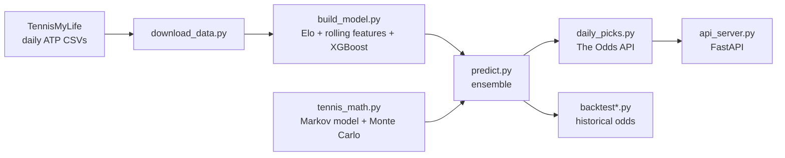
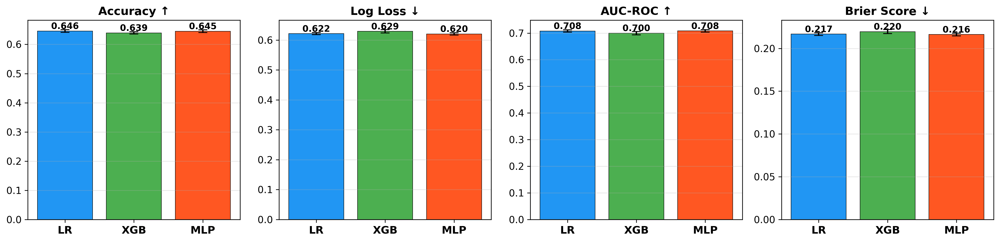
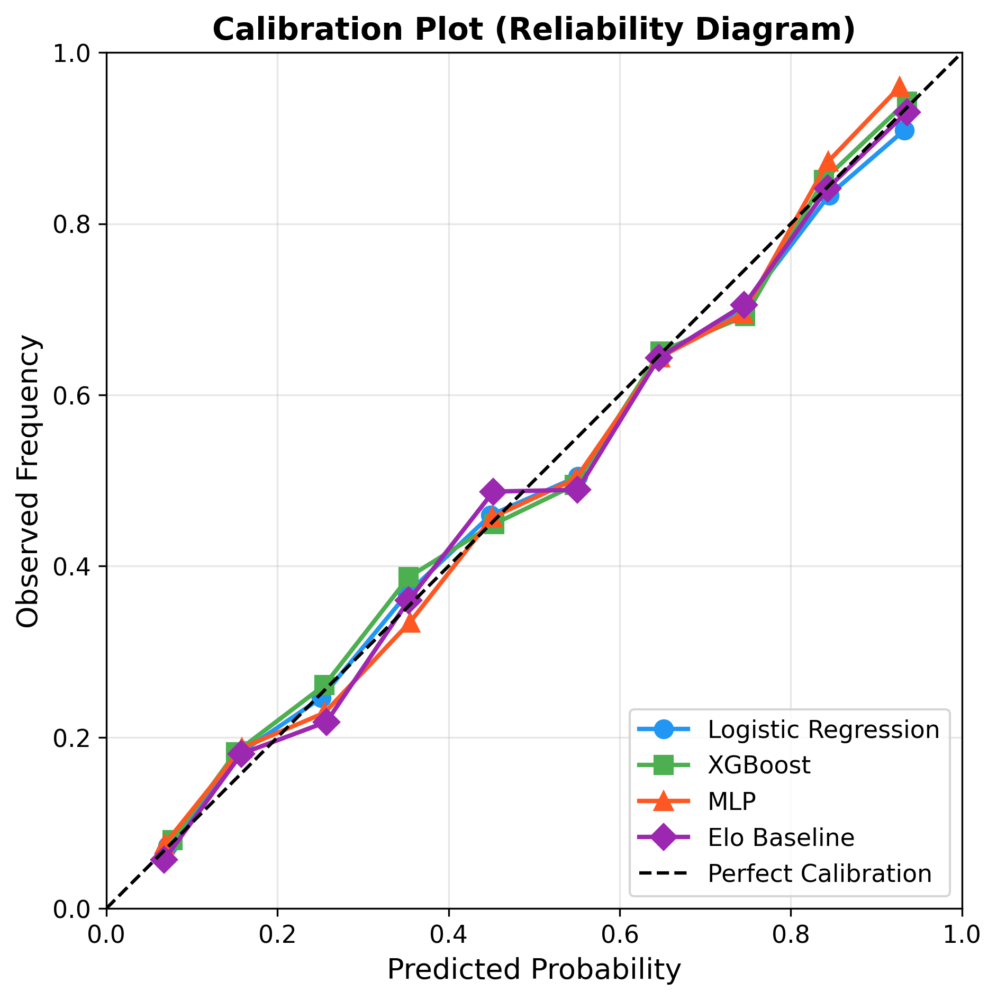
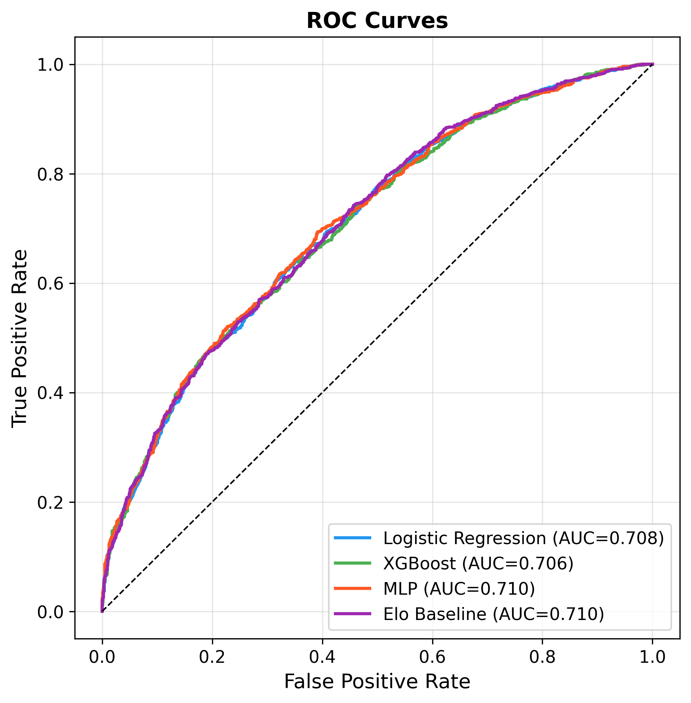
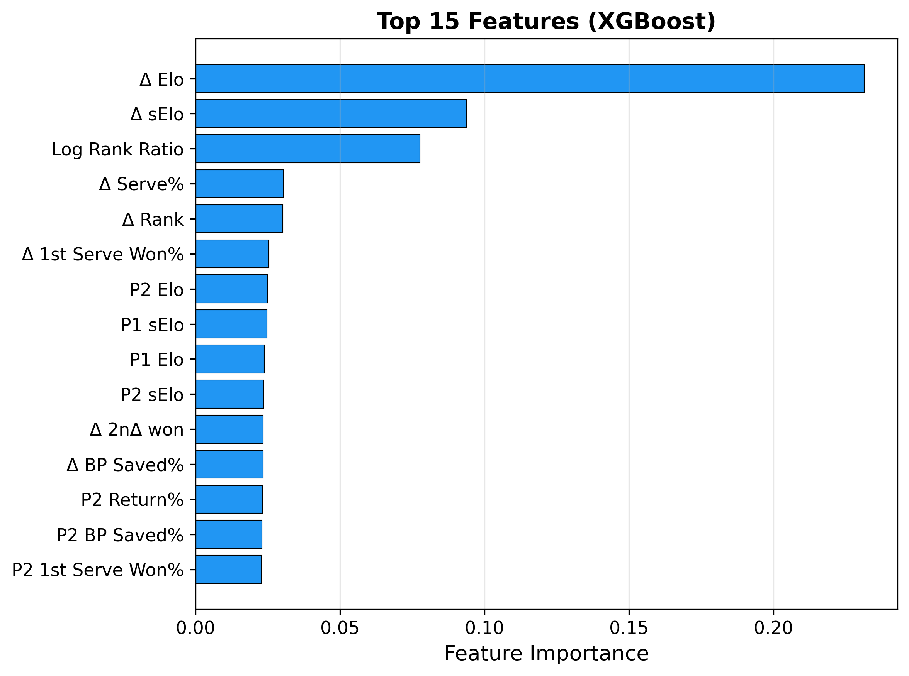

# 🎾 TennisPicks — ATP Match Prediction Engine

End-to-end machine learning system that predicts ATP tennis match outcomes. It ingests daily match data, engineers player features, combines a rating system, a point-level probability model and Monte Carlo simulation into an ensemble, backtests against historical betting odds, and serves daily predictions through a REST API.

> Personal project (2026). Not deployed publicly. Data and trained model artifacts are not committed; everything is reproducible from the scripts below.

## How it works



**1. Data.** 2018–2026 ATP matches from [TennisMyLife](https://stats.tennismylife.org), updated daily (serve and return statistics per match).

**2. Features (`build_model.py`).**
- Overall and surface-specific **Elo ratings**.
- Rolling serve/return statistics per player (exponentially weighted, span 20): points won on serve and return, 1st-serve win %, break points.
- Matchup features as differences between players.
- **Leakage control:** features only use matches played *before* the match being predicted. An earlier version that included features such as win streaks and recent match counts inflated accuracy to 84%. Removing them brought it back to an honest ~64–65%.

**3. Probability models.**
- **Elo** win probability.
- **Analytical Markov model** (`tennis_math.py`): converts each player's serve/return point probabilities into game → set → match win probability.
- **Monte Carlo simulation**: plays the match point by point (default 30,000 simulations) and returns the win probability and the full scoreline distribution.
- **Ensemble:** 40% Elo + 30% Monte Carlo + 30% analytical.

**4. Model comparison (`project_models.py`).** Logistic Regression, XGBoost and a PyTorch MLP evaluated with time-series cross-validation (`TimeSeriesSplit`), so models are always tested on future matches.

| Model | Accuracy | Log Loss | AUC-ROC | Brier |
|---|---|---|---|---|
| Logistic Regression | 0.646 ± 0.005 | 0.622 | 0.708 | 0.217 |
| XGBoost | 0.639 ± 0.004 | 0.629 | 0.700 | 0.220 |
| MLP (PyTorch) | 0.645 ± 0.005 | 0.620 | 0.708 | 0.216 |
| Elo baseline | 0.637 | 0.619 | 0.710 | 0.216 |

**Takeaway:** all models land at ~64–65% accuracy, very close to a well-tuned Elo baseline. This is consistent with tennis being a hard-to-beat, efficient market, and it is why the project focuses on calibration and on where the model disagrees with the bookmakers rather than on raw accuracy.

**5. Backtesting against the market.**
- `backtest_with_odds.py` and `backtest_all_markets.py` compare model probabilities with historical closing odds from [tennis-data.co.uk](http://www.tennis-data.co.uk) (2024–2026). They compute edge, hit rate and ROI by market and edge threshold.
- `verify_predictions.py` checks predicted winners and expected games and sets against real results.
- `sim_montecarlo.py` simulates a full tournament draw (Monte-Carlo Masters 2026) and compares it with what actually happened.

**6. Daily pipeline and API.**
- `daily_picks.py` finds today's matches through The Odds API, generates predictions and saves the picks.
- `scheduler.py` automates the daily run.
- `api_server.py` is a FastAPI backend with endpoints for daily picks, pick history, performance stats and tier-based access.

## Figures

| | |
|---|---|
|  |  |
|  |  |

More in [`docs/figures`](docs/figures).

## Quick start

```bash
pip install -r requirements.txt

python download_data.py              # 2018–2026 ATP data -> data/
python build_model.py                # Elo + features + XGBoost -> model/

python predict.py "Jannik Sinner" "Carlos Alcaraz"
python predict.py "Carlos Alcaraz" "Novak Djokovic" --clay --best_of 5
python predict.py --top 30
```

Optional:

```bash
cp .env.example .env                 # add ODDS_API_KEY for live matches
python daily_picks.py
uvicorn api_server:app --port 8000

python project_models.py             # model comparison + figures (needs torch)
python backtest_with_odds.py         # needs tennis-data.co.uk files in odds_data/
```

## Project structure

| File | Purpose |
|---|---|
| `download_data.py` | Downloads ATP match CSVs from TennisMyLife |
| `build_model.py` | Elo ratings, rolling features, matchups, XGBoost training |
| `tennis_math.py` | Point-level Markov model and Monte Carlo match simulator |
| `predict.py` | Ensemble predictor for any two players (CLI) |
| `project_models.py` | LR vs XGBoost vs MLP comparison with time-series CV and plots |
| `backtest.py`, `backtest_with_odds.py`, `backtest_all_markets.py` | Backtests against results and historical odds |
| `verify_predictions.py` | Validates winners, games and sets against actual results |
| `sim_montecarlo.py` | Full tournament draw simulation |
| `daily_picks.py`, `scheduler.py` | Daily prediction pipeline |
| `api_server.py` | FastAPI backend |

## Tech stack

Python · pandas · NumPy · scikit-learn · XGBoost · PyTorch · matplotlib · FastAPI · The Odds API

## Data sources

- ATP match data: [TennisMyLife](https://stats.tennismylife.org)
- Historical odds: [tennis-data.co.uk](http://www.tennis-data.co.uk)
